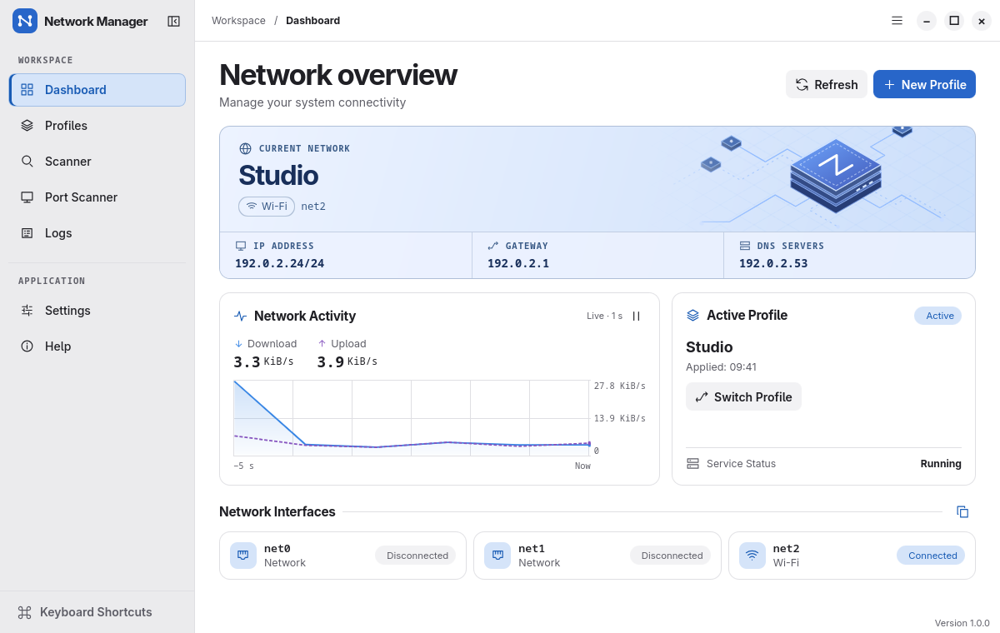

# Network Manager

<div align="center">

<picture>
  <source media="(prefers-color-scheme: dark)" srcset="docs/workspace-dark.webp">
  
</picture>

**Save your network settings as profiles and switch between them in one click.**

Made for Fedora Workstation with GNOME.

</div>

---

## Install on Fedora

**[Download Network Manager 1.1.0 for Fedora 45 (x86_64)](https://github.com/christosdaggas/NetManager/releases/download/v1.1.0/network-manager-1.1.0-1.fc45.x86_64.rpm)** · [Release notes and checksum](https://github.com/christosdaggas/NetManager/releases/tag/v1.1.0)

From the folder containing the downloaded RPM, run:

```bash
sudo dnf install ./network-manager-1.1.0-1.fc45.x86_64.rpm
```

Open **Network Manager** from the app grid. The same command upgrades a 1.0.0
installation. Version 1.1.0 replaces the GTK4 interface with Tauri and keeps
your profiles, settings, and logs in `~/.local/share/daggas/network-manager/`.

## Desktop workspace

The workspace has seven pages: **Dashboard**, **Profiles**,
**Scanner**, **Port Scanner**, **Logs**, **Settings**, and **Help**. The dashboard
shows the current connection, address, gateway, and DNS in a blue network panel.
Below it are live traffic, the active profile, service status, and local interfaces.
The menu in the header contains the theme
chooser, Preferences, About, and Quit.

Profile editors, the switcher, preferences, diagnostics, device details, and
scheduling/shortcut managers open in separate movable Tauri windows. The two
scan pages keep their work and results when navigating between pages.

Global profile shortcuts use the desktop's GlobalShortcuts portal when
available; configured shortcuts also work in the focused window.

The sidebar fills the window height. Use its header button or **Ctrl+B**
to switch between labels and an [icon rail](docs/workspace-compact.webp). The workspace remembers that choice,
window placement, last page, theme, and sampling
interval. Traffic history is session-only. Press **Ctrl+1–7** to navigate,
**Ctrl+N** to create a profile, **Ctrl+P** to switch, **Ctrl+D** for diagnostics,
**Ctrl+Shift+C** to copy network information, **F5** to refresh, or **F1** for
Help. **Ctrl+?** lists the shortcuts. Profiles and logs support **Ctrl+F**.

### Verification

```bash
cargo test --locked
cargo build --locked --manifest-path src-tauri/Cargo.toml
python3 scripts/test-tauri-workspace.py
```

The UI smoke test needs a graphical Linux session, `dbus-run-session`, and
`WebKitWebDriver` (on Fedora, find its package with
`dnf provides '*/WebKitWebDriver'`). It opens the actual Tauri window using
a temporary home directory and a recording `nmcli` stub. The screenshots
above use sample profiles and anonymized network identifiers.

## What is it?

Do you move between home, the office and a café, and need different settings in
each place? Network Manager lets you save everything a place needs (IP address,
DNS, proxy, VPN, printer and more) as a **profile**. Pick a profile and the app
applies it for you. It can even switch profiles on its own when you arrive
somewhere.

## What it can do

- **Network**: IP addresses (automatic or fixed), DNS servers, routes, Wi-Fi and VPN connections
- **System**: hostname, proxy, firewall zone, default printer, timezone
- **Automatic switching**: change profile based on the Wi-Fi network, your router, or the time of day
- **Scheduling**: activate a profile at a set time
- **Connection watchdog**: get notified, or reconnect, when the connection drops
- **System tray**: show an icon and switch profiles from the tray (GNOME needs the AppIndicator extension)
- **Scripts**: run your own scripts before or after a profile is applied, optionally sandboxed
- **Privacy**: your profiles are stored only on your computer, optionally encrypted with a passphrase
- **Dashboard**: see your current connection at a glance
- **Network scanner**: discover devices on your LAN with names, MAC vendors, open services, Wake-on-LAN, and CSV export
- **Port scanner**: list the open TCP ports of a device, by address or name or straight from the network scanner
- Follows your GNOME light or dark style

## Getting started

1. Open **Profiles** and click **New Profile**.
2. Give it a name (for example "Office") and add the settings you need.
3. Click **Apply** to switch to it.
4. Optional: add rules so the profile turns on by itself when you connect to a certain Wi-Fi network.

## Build it yourself

```bash
sudo dnf install cargo rust gcc-c++ python3 gettext pkgconf-pkg-config gtk3-devel webkit2gtk4.1-devel glib2-devel gettext-devel openssl-devel librsvg2-devel rpm-build desktop-file-utils appstream
cargo build --release --locked
./target/release/network-manager
```

To build your own RPM package, run `./scripts/package-rpm.sh`. The package is saved in `dist/rpm/`.

## Updates and privacy

The app checks GitHub once at startup to see if a newer version is available
and shows a small notice if there is one. Connection checks ping 8.8.8.8 (the
watchdog target can be changed in Settings), and the optional speed test
downloads a file from Cloudflare. The network scanner sends pings and port
probes only to the address range you choose, and the port scanner connects
only to the device and ports you choose. The app does not collect or send
any personal data.

## Feedback and contributing

Found a bug or have an idea? [Open an issue](https://github.com/christosdaggas/NetManager/issues).
Want to help with the code? See [CONTRIBUTING.md](CONTRIBUTING.md).

## License

MIT. See [LICENSE](LICENSE).

## Author

**Christos A. Daggas**: [chrisdaggas.com](https://chrisdaggas.com) · [info@chrisdaggas.com](mailto:info@chrisdaggas.com)
